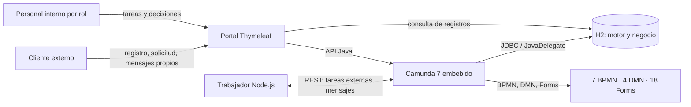

# Arquitectura y evidencias de la entrega final

## Alcance

El sistema académico automatiza tres procesos TO-BE de Agua de la Cumbre: PR-CO-03 distribución, PR-SO-04 equipos de campo y PR-SO-05 facturación y recaudo. Santiago Cardona Tovar, Brayan Steven Fernández Herrera y Andrés Felipe Carrasquilla Gutiérrez son los responsables de esos procesos, respectivamente. La liberación de lotes, la devolución y el pago se simulan como mensajes externos. No se integra una pasarela bancaria, DIAN ni el sistema real de producción.

## Componentes

Spring Boot sirve el portal en `127.0.0.1:8080`, aloja Camunda 7.24 y usa H2 persistente en `data/agua-cumbre.mv.db`. El trabajador Node.js resuelve tres *External Tasks*: traslado de venta, constancia de equipo y factura simulada. El traslado envía `VentaEntregada` e inicia PR-SO-05, conservando el solicitante del portal. Los cambios de inventario, equipos y cartera se hacen desde JavaDelegate en la transacción del motor. Los archivos BPMN, DMN y Forms editables están en `src/main/resources/static/` y en las carpetas `PR-*` del ZIP original.

## Usuarios y autorización

El cliente puede registrarse en `/registro`, iniciar distribución o solicitud de equipo, ver únicamente sus instancias y enviar devolución o pago de sus casos cuando el proceso los espere. El portal asocia `solicitantePortal` a cada instancia y transmite la asociación a la facturación automática. El personal interno ve las tareas de sus grupos candidatos y puede completarlas; los eventos corresponden a bodega/calidad, administración o tesorería. Solo `admin` entra a Cockpit y a `/engine-rest/**`. Las verificaciones se hacen también en el servidor antes de cada acción; ocultar enlaces por sí solo no concede ni quita permisos.

La cuenta `admin` viene de la configuración de Camunda. En una base nueva se crean cuentas de demostración `vendedores`, `bodega`, `administracion`, `tesoreria` y `tecnicos`, cada una en su grupo homónimo. La contraseña de demostración es `demo1234` o el valor de `DEMO_USER_PASSWORD`. Cambiarla antes de mostrar el sistema fuera de un entorno local.

## Correspondencia con la rejilla final

| Criterio | Evidencia en esta carpeta | Estado comprobable |
|---|---|---|
| Contexto y alcance | Este documento, README y documento de identificación del ZIP | Documentado |
| Arquitectura | Diagrama y explicación anterior | Documentado |
| Modelado BPMN | `src/main/resources/static/bpmn/`, diagramas en `docs/diagramas/` | Siete modelos editables |
| Ejecución Camunda 7 | `ProcesosTest`, DMN, mensajes, temporizadores y Call Activities | Probado por Maven; demostración visual local pendiente |
| Aplicación externa | `/registro`, formularios de inicio, seguimiento y mensajes propios | Integrada; pruebas de acceso en `PortalTest` |
| Aplicación interna | Cola por grupos candidatos, formulario leído de `formRef`, completar tarea | Integrada; pruebas de roles en `PortalTest` |
| Automatización e integración | `worker-js/worker.cjs`, JavaDelegate, REST de Camunda | Pruebas unitarias y de motor; recorrido con worker debe demostrarse localmente |
| Persistencia y datos | `schema.sql`, `DemoData.java`, `docs/consultas.sql` | H2 de archivo e inicialización reproducible |
| Multirepositorio | Fuente original y componente de aplicación en una sola entrega | **Pendiente**: publicar hub y componentes en repositorios accesibles si el docente lo exige |
| Instalación y configuración | README, `pom.xml`, `application.yaml`, scripts `.cmd` | Comandos y parámetros documentados |
| Pruebas y demo integral | `ProcesosTest`, `PortalTest`, `worker.test.cjs`, `VALIDACION.md` | Pruebas automáticas; falta ensayo completo en equipo de presentación |

La rúbrica anterior de siete elementos de BPMN, cubierta en `docs/RUBRICA.md`, es distinta de la rejilla final de once criterios. Esta tabla no asigna calificaciones: indica evidencia verificable y lo que todavía requiere acción del equipo.

## Datos y límites

`schema.sql` crea tablas de lotes, pedidos, equipos, cuentas, pagos y movimientos; Camunda guarda sus propias instancias e historial en la misma base. `DemoData.java` carga registros de ejemplo si no existen. La llave de negocio conecta el pedido con facturación y los movimientos incluyen la instancia. El sistema escucha solo en localhost de forma predeterminada. Se requiere acceso físico o una configuración de red explícita para una demostración desde otro equipo.
